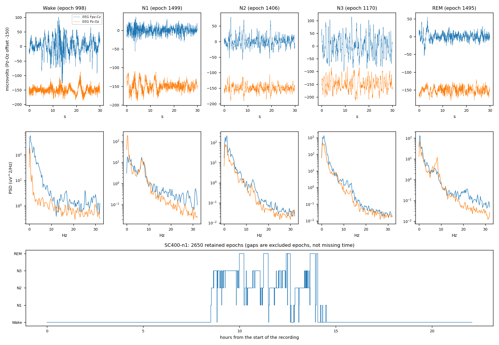
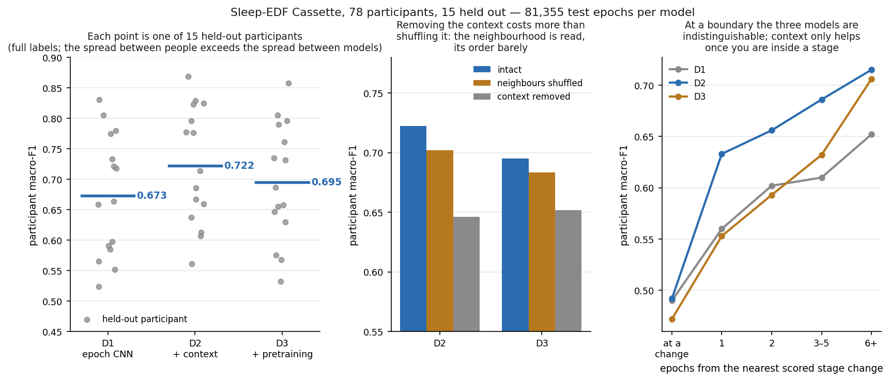

# SleepStateLab

**Self-supervised EEG representation learning and sleep-state decoding.**

The question: *does self-supervised representation learning improve
cross-participant sleep staging when labels are scarce, and does the benefit
concentrate around stage transitions or survive with fewer EEG channels?*

This is a research implementation, not a result. What has been built, what has
been run, and what has not, is stated in the next section and is not softened
anywhere else in this document.

---

## Status — read this before any number below

| | state |
| --- | --- |
| **the question** | *does self-supervised pretraining help sleep staging when labels are scarce?* |
| **the answer so far** | **partially answered, and underpowered.** Pretraining helps by +0.030 at a 10% label budget and +0.020 at 25%, and by nothing at 100%. The trend is monotonic and matches an independent control. At every budget the effect is smaller than the seed-to-seed spread, so it is a direction, not a measurement. |
| **built** | the whole pipeline: audit, epoching, splits, three models, six controls, transition analysis, benchmark harness, 209 tests |
| **run on real data** | all 153 Sleep Cassette recordings, 78 participants. D1, D2, D3 and all six controls on 15 held-out participants. 14 of the benchmark's 18 cells. |
| **not run** | 4 of 18 benchmark cells (100% budget, seeds 1–2); the stricter setting where validation shrinks with the budget |
| **why not** | the machine. A 16 GB laptop kernel-panicked twice under the memory load; see [the resource write-up](#what-it-actually-costs-to-run-this). |
| **run without any data** | `sleepstatelab smoke` — the whole pipeline on generated recordings, on a CPU, in about four minutes |

A longer breakdown of what was built against what was executed is in
[docs/status.md](docs/status.md). Every number in this README was computed from
saved per-epoch predictions by `sleepstatelab report`; none was typed in by hand.

**The full cohort is now prepared.** All 153 Sleep Cassette recordings from 78
participants, every file matching its published PhysioNet checksum, no recording
with a problem: **414,961 stored epochs, 414,481 eligible** after quality
control, of which 480 were rejected as clipped, 1,335 were unscored and 128 were
movement time. Wake is 68.8% of the labelled epochs, N2 16.7%, REM 6.2%, N1
5.2%, N3 3.1%. The cohort split is 47 training / 16 validation / 15 test
participants (`outputs/split_cohort.json`, identity `2a0313adb97b9da0`).

**D1, D2 and D3 have all been trained and scored on the cohort**: 47 training,
16 validation, 15 held-out participants, 81,355 test epochs, with both context
controls for each temporal model. The six-participant pilot results are kept
below, labelled, because two of its findings were overturned by the cohort and
that is worth being able to see.

**The experiment the repository exists for has been run, and is underpowered**:
14 of the label-budget benchmark's 18 cells, covering 10% and 25% completely
and 100% at one seed. The declared comparison — D3 minus D2 at 25% — is
[reported below](#the-label-budget-benchmark--primary-comparison). What remains
missing is the 100% budget's other two seeds, a second participant split, and
the stricter setting where validation shrinks with the budget.

**D1 and D2 have been run at matched compute — on one held-out participant.**
Sharing encodings between overlapping windows made a D2 pass cost the same as a
D1 pass, so D2 has now been trained for the same twenty passes under the same
settings. With one test participant the difference between any two models here
is still not a measurement, and the README does not treat it as one.

There are no pretrained checkpoints in this repository, and no claim that the
label-efficiency question is settled — only that it now has a direction, three
seeds wide, from one split.

---

## What this is, and what PhysioML is

[PhysioML](https://github.com/Elnazkarami/Physiological-Signal-ML-) is the
existing classical-machine-learning and traceability project by the same author.
SleepStateLab is separate and owns neural-network training and representation
learning. PhysioML was read for its verified dataset handling and feature
definitions and **was not modified by this work**; nothing here imports it, and
**SleepStateLab runs with no CDFS deployment of any kind**.

Two components were taken as attributed, versioned extractions — the spectral
feature definitions and the EEG quality-control thresholds — and both name their
origin and revision. What was taken, what was changed, and what was deliberately
left behind is in [docs/physioml_reuse.md](docs/physioml_reuse.md).

**PhysioML's published sleep scores are context, not baselines.** They were
computed on cropped recordings, with four channels including the EOG and chin
EMG, on a different participant set, pooled differently. The classical baselines
are re-run here on matched participants, channels, eligible epochs, labels and
splits, and only those re-run numbers are compared with D1.

The 20-participant development subset **has been used before**, in PhysioML. It
is a development set with a recorded history, not an untouched confirmation
cohort.

---

## Try it without any data

The whole pipeline runs on generated recordings, on a CPU, with nothing
downloaded:

```bash
pip install -e ".[dev,plots]"
sleepstatelab smoke --out-dir outputs/smoke
```

It writes real EDF files, reads them back through the same reader the
recordings use, epochs them with deliberate gaps, splits participant-disjoint,
fits the three baselines, trains D1, pretrains an encoder by masked
reconstruction, trains D2 and D3, runs the context controls, saves per-epoch
predictions and generates the report tables — then checks that D1 can overfit a
tiny batch, and exits non-zero if it cannot.

**Measured cost: 2 min 12 s wall-clock and 824 MB peak resident memory** on the
M2 Pro described below, CPU only (`/usr/bin/time -l`, 320 s of user time across
cores). It needs no GPU, no external drive and no recordings.

Every artefact it writes is labelled synthetic. It is a demonstration that the
software works end to end, not an experiment: the signals are sine waves with a
different spectrum per stage, and **no number it prints says anything about
sleep.**

## Install

```bash
git clone https://github.com/Elnazkarami/sleep-state-lab.git
cd sleep-state-lab
pip install -e ".[dev,plots]"
sleepstatelab doctor --device auto
```

Python 3.11+. `doctor` reports what this machine actually offers:

```
torch 2.8.0
cpu: available
cuda: not available
mps: available
```

**CPU is always selectable** with `--device cpu`, and a run that asks for an
absent accelerator raises rather than silently falling back — a benchmark that
quietly ran for a week on the wrong hardware is worse than one that refused to
start. CUDA and MPS are probed, never assumed.

Every pilot result below was produced on CPU. The cohort D1 run used Apple MPS,
which on this machine was **24× faster** for D1: 17 ms against 422 ms for a batch
of 64 — the difference between a nine-hour sequence of passes and a half-hour
one.

**Available is not the same as working, and `doctor` now says which.**
Partway through the cohort work this machine's Metal shader compiler became
unreachable. `torch.backends.mps.is_available()` went on returning `True`, and
the next convolution killed the process with an assertion rather than an
exception, taking a training run with it. So a device is now checked by *using*
it — a small convolution and a backward pass, run in a subprocess, because a
failure of that kind cannot be caught in the process it happens in:

```
$ sleepstatelab doctor --device auto
cpu: available, and a test operation ran
cuda: not available
mps: available, but a test operation FAILED
resolved device for --device auto: cpu
```

Asking for a broken device by name raises before any work starts. `auto` steps
over it, since nothing was requested by name and so nothing is being silently
substituted.

The two devices agree: a checkpoint trained on MPS and then evaluated on both
produced **identical predicted labels** on the held-out participant, with a
maximum probability difference of 7.75e-07. A result is therefore not a property
of which device produced it — but the device is recorded in every checkpoint and
run record anyway, because that is the sort of thing one wants to be able to
check rather than assume.

## Get the data

Sleep-EDF Expanded 1.0.0, **Sleep Cassette only**:
<https://physionet.org/content/sleep-edfx/1.0.0/>. The dataset is not
redistributed here and nothing in this package downloads it for you. Put the
`SC4*-PSG.edf` and `SC4*-Hypnogram.edf` files under a directory of your
choosing and point `--data-root` at it. Fetching PhysioNet's `SHA256SUMS.txt`
alongside them lets the audit verify each file against its published digest.


### Putting the data on a slow external drive

The epoch cache and the recordings can live anywhere, including a USB drive. The
**materialised store cannot**, or should not: it is read in shuffled order, one
epoch at a time, for every pass of training. Measured on a USB exFAT volume
here, a random 24 KB read costs 10–15 ms, which is 40–60 minutes of pure waiting
per pass over the cohort. The same file on internal storage is served from the
page cache and costs nothing.

So point them at different places:

```bash
sleepstatelab train-d2 --config configs/default.yaml \
    --data-root /Volumes/external/sleep-edf-data \
    --cache-dir  /Volumes/external/sleep-edf-data/cache \
    --store-dir  ~/sleepstatelab-store
```

The recordings (7 GB) and the epoch cache (4.6 GB) stay on the external volume,
where they are read sequentially and rarely. The materialised store (about 10 GB
for the whole cohort) goes on internal storage, where the random reads are free.
`store_dir` in the configuration does the same thing permanently.

On exFAT specifically, two more things. Run `git config core.filemode false` in
the checkout — exFAT cannot store the executable bit, so git otherwise reports
every file in the repository as modified. And be aware that macOS writes an
AppleDouble sidecar called `._name` beside every file on such a volume: these
look exactly like data to a directory scan, so `._SC4001E0-PSG.edf` would be
discovered as a recording. Every place this package scans a directory skips
them, and a test puts a sidecar beside every file and checks that nothing
changes.
---

## Run it

Every command below is one that was actually executed to produce what this
repository contains. `$D` is the data root.

```bash
# 1. discover, pair, validate, and write the manifest
sleepstatelab audit   --config configs/pilot.yaml --data-root $D \
                      --checksums $D/SHA256SUMS.txt --output outputs/manifest.json

# 2. cut every recording into scored 30-second epochs and cache them
sleepstatelab prepare --config configs/pilot.yaml --data-root $D --cache-dir $D/cache

# 3. the audit of one real recording: waveforms, spectra, hypnogram, exclusions
sleepstatelab audit-report --config configs/pilot.yaml --data-root $D \
                      --recording SC400-n1 --out-dir docs/audit

# 4. the participant-disjoint split
sleepstatelab split   --config configs/pilot.yaml --data-root $D --cache-dir $D/cache \
                      --name pilot6 --output outputs/split.json

# 5. classical baselines on the eligible epochs
sleepstatelab baselines --config configs/pilot.yaml --data-root $D --cache-dir $D/cache \
                      --split outputs/split.json --part test \
                      --output outputs/predictions_pilot.csv

# 6. train D1
sleepstatelab train-d1 --config configs/pilot.yaml --data-root $D --cache-dir $D/cache \
                      --split outputs/split.json --device cpu \
                      --checkpoint runs/d1_pilot/checkpoint.pt

# 7. save one prediction row per test epoch
sleepstatelab predict --config configs/pilot.yaml --data-root $D --cache-dir $D/cache \
                      --split outputs/split.json --checkpoint runs/d1_pilot/checkpoint.pt \
                      --part test --output outputs/predictions_pilot.csv --append

# 7b. D2: the same encoder under a transformer over eleven epochs (offline)
sleepstatelab train-d2 --config configs/pilot.yaml --data-root $D --cache-dir $D/cache \
                      --split outputs/split.json --device cpu --epochs 6 \
                      --checkpoint runs/d2_pilot/checkpoint.pt
sleepstatelab predict --config configs/pilot.yaml --data-root $D --cache-dir $D/cache \
                      --split outputs/split.json --checkpoint runs/d2_pilot/checkpoint.pt \
                      --part test --output outputs/predictions_pilot.csv \
                      --model-name D2 --append

# 7c. the control: same model, neighbours shuffled
sleepstatelab predict --config configs/pilot.yaml --data-root $D --cache-dir $D/cache \
                      --split outputs/split.json --checkpoint runs/d2_pilot/checkpoint.pt \
                      --part test --output outputs/predictions_pilot.csv \
                      --model-name D2-shuffled-context --append \
                      --shuffle-context --shuffle-seed 1

# 8. build the tables from the saved predictions
sleepstatelab report  outputs/predictions_pilot.csv --part test \
                      --output docs/results_pilot.md --json outputs/metrics_pilot.json
```

No recordings, credentials, caches or checkpoints are committed: the data root,
the epoch cache, `runs/` and `outputs/` are all ignored.

**With no data at all**, the whole pipeline still runs on generated recordings:

```bash
sleepstatelab smoke --out-dir outputs/smoke
```

It writes real EDF files, reads them back through the same reader, epochs them
with deliberate gaps, splits, trains, checkpoints, reloads, predicts and scores —
and labels every artefact synthetic.

---

## How the data is handled

Full detail in [docs/data_audit.md](docs/data_audit.md); the decisions that
change what a number means:

* **Sleep Cassette only.** Sleep Telemetry files are not matched and are listed
  as ignored, never quietly mixed in.
* **A participant is not a recording.** `SC4001` and `SC4002` are two nights of
  one person and always land in the same split.
* **Pairing is by participant and night**, because the hypnogram's file stem
  differs from the PSG's.
* **Two EEG derivations, in a fixed order**: `EEG Fpz-Cz` then `EEG Pz-Oz`.
  Channel order is part of the model's contract and a checkpoint records it.
* **Units are read, not assumed.** The EDF header is parsed directly for the
  declared physical dimension, because an established reader has already
  converted to volts by the time anything is visible. An unrecognised unit
  raises rather than being scaled by a guess.
* **100 Hz is required, not enforced by resampling.** A recording at another
  rate raises.
* **PSG and hypnogram start times must agree**, or the recording is flagged. If
  they did not, every label would be shifted and nothing downstream would
  notice.
* **Stages 3 and 4 merge into N3**; the original annotation text is stored per
  epoch so the merge can be undone.
* **`Movement time` and `Sleep stage ?` are never labels.** They are exclusions
  with a reason, and they never become wake.
* **Original epoch indices survive.** An excluded epoch leaves a visible jump in
  the index. Nothing treats two rows as neighbours because they are adjacent in
  an array.
* **Primary preparation keeps every valid scored epoch** — no sleep-stage-based
  cropping. Wake is therefore about 70% of the epochs, which is what the
  recordings are. The crop to the annotated sleep interval plus a margin exists
  as a separately labelled sensitivity analysis
  (`configs/sleep_window_sensitivity.yaml`) and is not mixed with primary
  results.
* **Normalisation is fitted on training participants only** — one median and one
  IQR per channel, frozen, hashed, and recorded in every checkpoint. Per-epoch
  z-scoring is available and is *not* the default: it deletes the absolute
  amplitude that separates N3 from N1.

Run on the same twelve recordings, the primary preparation and the sensitivity
analysis are barely the same task:

| preparation | eligible epochs | Wake | N1 | N2 | N3 | REM |
| --- | ---: | ---: | ---: | ---: | ---: | ---: |
| primary (no cropping) | 33,111 | 68.4% | 3.5% | 17.0% | 4.6% | 6.5% |
| sleep-window + 30 min | 12,501 | 16.2% | 9.3% | 45.1% | 12.1% | 17.2% |

Cropping discards 20,616 of 33,111 epochs and takes wake from 68% to 16%. A
model scored under the second is being asked a different question from one
scored under the first, and **accuracy in particular means something else**.
Every published sleep-staging number depends on which was done, and not every
paper says. That is why the default here is the uncropped one, why the crop has
its own configuration file rather than a flag, and why it writes to its own
epoch cache.

**The audit of one real recording** — checksums, header claims, waveforms and
spectra for each stage, hypnogram alignment, retained counts and every exclusion
— is in [docs/audit/SC400-n1_audit.md](docs/audit/SC400-n1_audit.md), generated
by `sleepstatelab audit-report`.



The eight and a half hours of wake before sleep onset, visible at the left of
the hypnogram, is why the class balance is what it is and why accuracy is not a
metric this repository reports alone.

---

## Splits and leakage

Participant-disjoint train / validation / test, generated deterministically from
a seed. All nights of a participant go to one split — a `Split` that shares a
participant **cannot be constructed**, and a split file carries a hash of its
participant lists so an edited file is detected on load.

**No test participant contributes to** normalisation statistics, hyperparameter
selection, early stopping, calibration, or self-supervised pretraining. The
first is enforced in code, the second and third by selecting only on validation,
and the last is a stated requirement of the D3 contract.

Nested 10% / 25% / 100% training-participant budgets are generated for the
planned benchmark. **As implemented, a reduced budget does not reduce the
validation set** — a 10% run still selects its checkpoint on the full validation
labels, which is more supervision than a true 10%-label setting. Any budget
result must disclose this.

---

## D1 — the trainable epoch CNN

One 30-second epoch in; five logits, an embedding, and temporal tokens out.

```
input          [batch, 2, 3000]        Fpz-Cz first, Pz-Oz second, microvolts
stem           Conv1d(2->32, k=49, s=6) - GroupNorm - GELU - MaxPool2
block 1        2 x Conv1d(k=9) -> 64   - GroupNorm - GELU - MaxPool2
block 2        2 x Conv1d(k=9) -> 96   - GroupNorm - GELU - MaxPool2
block 3        2 x Conv1d(k=9) -> 128  - GroupNorm - GELU - MaxPool2
tokens         [batch, 128, 31]        ~0.5 s of signal each, for D2/D3
embedding      mean-pool + max-pool over time -> Linear -> [batch, 128]
head           Dropout(0.3) -> Linear(128 -> 5) -> five unnormalised logits
```

**489,477 parameters** — 488,832 encoder, 645 head.

* **The head is a separate module.** `D1Classifier.from_encoder(encoder)`
  attaches a fresh head to an existing backbone; that is the seam D2 and D3
  reuse, so their comparison measures initialisation rather than architecture.
* **GroupNorm, not BatchNorm.** Batch statistics would make a prediction depend
  on who else is in the batch, and BatchNorm's running statistics carry a piece
  of the training distribution into inference on a new participant.
* **Initialisation** is Kaiming fan-out for convolutions, Xavier for linear
  layers, written out rather than left to defaults.
* **Loss** is cross-entropy weighted by inverse class frequency, normalised to a
  mean of one, computed on **training participants only**.
* **Optimiser** AdamW, learning rate 1e-3, weight decay 1e-4, cosine schedule,
  gradient-norm clipping at 5.
* **Stopping rule** is validation participant-mean macro-F1, with patience.
  Never loss, never anything measured on test. The checkpoint kept is the best
  validation epoch, and which epoch that was is recorded.

**Every checkpoint carries its contract**: configuration and its hash, seed,
code revision, split identity and participant lists, channel order,
preprocessing identity, normalisation statistics, label order, selected epoch
and its validation score, and the full training history. Loading refuses a
checkpoint whose channel order or preprocessing identity does not match the
configuration it is being loaded into.

---

## D2 — temporal context

The same encoder, applied to eleven consecutive epochs — five before, the
central epoch, five after — then a two-layer transformer across those eleven
embeddings, then the head on the **central position only**.

**756,229 parameters**: 488,832 in the encoder, which is bit-for-bit D1's,
266,752 in the temporal stack, 645 in the head. A test asserts that a D1 and a
D2 built from the same encoder object share it and produce identical embeddings.

**This is an offline model.** Predicting the middle of eleven epochs uses 2.5
minutes of future signal. It is not a real-time scorer and comparing it against
one would be unfair in D2's favour.

**Masking is the part that has to be right**, and it lives in the dataset, not
the model, so a window handed to a model is already correct:

* a window never leaves its recording, so it can never reach into another night
  or another participant;
* position *k* of a window centred on epoch *i* is the epoch whose **original
  index** is `i + k − 5`, or nothing at all. If that epoch was excluded, the
  position is marked absent — the nearest surviving epoch is never substituted,
  because it is a different point in the night;
* the start and end of a recording are absences of the same kind, not zero
  padding, which would teach the model that a boundary looks like a flat signal;
* absent positions get a learned token *and* are excluded from attention;
* the centre is always a real, eligible, labelled epoch, and the model raises if
  it is ever handed a window whose centre is masked.

Every one of those is a test in `tests/test_d2.py`, including the two that
matter most: with all neighbours masked, changing them does not move the logits
at all; with them present, it does.

**Two controls, not one.** `predict --shuffle-context` permutes the neighbours,
which asks whether their *order* is used. `predict --mask-context` marks them
all absent, which asks whether they are used *at all*. They are different
questions and the CLI refuses to run both at once, so a saved result always says
which was asked.

**Genuine-neighbour coverage** — the share of context positions that are real —
is computed per dataset and reported with any D2 run. On the pilot it is 0.999,
because these recordings have almost no excluded epochs; on a noisier cohort it
would be lower and the number says so.

D2 is trained by the same `train_supervised` routine as D1, with class weights
from the same shared helper, so the two cannot drift apart in the ways that
would make their difference mean something other than context.

**Shared encodings.** Overlapping windows share ten of their eleven epochs, so
training and inference encode a contiguous stretch of a recording once and gather
the windows out of it — 32 centres cost 42 encodings rather than 352. On the
pilot that is 14,532 encodings per pass instead of 120,945, and **107 seconds per
pass instead of 827** — the same cost as a D1 pass, which is what made the
matched comparison affordable. It is the
same model: one test asserts the two paths produce the same logits, another that
they produce the same probabilities end to end, and `--no-segments` keeps the
slow path available to check against. The cost is that a batch is several
stretches rather than several independent windows, so its examples are
correlated in time; the encoder carries no batch statistics, so nothing in the
model depends on that.

---

## D3 — self-supervised pretraining

D3 is not a third architecture. It is D2, with its encoder started from
self-supervised masked reconstruction instead of random weights — which is why
it is literally the same command: `train-d2 --init-encoder`.

**The task.** Cut an epoch into patches, hide half of them, reconstruct what was
hidden from what was left. No labels are read at any point, including for the
stopping rule: pretraining selects on held-out *reconstruction* loss, computed
under a fixed mask so two passes hide the same patches.

**The property everything rests on: a hidden value never reaches the encoder.**
Masking happens in signal space, before the encoder sees anything — hidden
samples are *replaced* by a learned per-channel constant, not attenuated, not
scaled. It is easy to write a masked autoencoder that leaks, and the leak is
invisible in the loss curve: it looks like a model that is good at its task. So
it is asserted directly. `test_hidden_values_never_reach_the_encoder` changes the
signal inside the hidden patches and requires the encoder's input to be
identical element for element; `test_hidden_values_do_not_move_the_embedding`
requires the same of the representation.

**The patch is derived from the encoder, not chosen** — one token per patch, 96
samples, 0.96 s. The decoder reconstructs each patch from the token covering it,
so a patch straddling tokens would ask an output block to answer for input it
never saw. The first decoder written here interpolated tokens up to sample rate,
which cannot represent anything above about half a hertz; sleep spindles are at
12–16 Hz, so that encoder would have been trained to throw them away. A test now
fits a 13 Hz signal and checks the residual. The tokens cover 2,976 of 3,000
samples; the 24-sample tail is never masked and never scored.

**The decoder is 20,776 parameters against the encoder's 488,832**, and is
discarded afterwards. A strong decoder can reconstruct from a weak
representation, which moves the work out of the only part that is kept.

**Pretraining sees training participants only.** The encoder checkpoint records
whose data it saw; loading it into a run that holds out any of them raises,
rather than producing a result that looks fine and means nothing.

---

## Running it on free cloud compute

The benchmark needs more memory than a 16 GB laptop has — see
[what it costs](#what-it-actually-costs-to-run-this) for the kernel panic that
established this. [docs/running_on_kaggle.md](docs/running_on_kaggle.md) is a
worked setup for Kaggle Notebooks, which give roughly 29 GB of RAM and a GPU
free: what to upload (the 4.4 GB epoch cache and the pretrained encoder, not the
recordings), how the three storage areas differ, how to chain sessions past the
12-hour cap, and which experiments to spend the weekly GPU allowance on.

The short version of that last point: a second participant split and the
stricter `--reduce-validation` setting are worth more than finishing the
100%-budget row, whose answer is already established twice.

## Resuming an interrupted run

Training writes a `.state.pt` beside its checkpoint after every pass, holding
the optimiser, the scheduler, the epoch counter, the best score so far and the
Python, NumPy and torch RNG states. Re-running the same command continues from
the last completed pass:

```bash
sleepstatelab train-d2 --config configs/default.yaml --split outputs/split_cohort.json \
    --checkpoint runs/cohort_d2/checkpoint.pt      # interrupted at pass 12
sleepstatelab train-d2 --config configs/default.yaml --split outputs/split_cohort.json \
    --checkpoint runs/cohort_d2/checkpoint.pt      # resumes at pass 13
```

The RNG states are the part that is easy to leave out and should not be: without
them a resumed run sees a different shuffle, which makes it a different
experiment wearing the same name. State written under a different configuration
or split is refused rather than loaded, and a clean finish deletes it — so the
file's presence means "this did not end properly" and its absence means there is
nothing to resume.

The benchmark resumes at a coarser grain too: it reads its predictions file and
skips cells that already have rows, so the nightly job continues an unfinished
sweep and exits in seconds when there is nothing left.

## What it actually costs to run this

"Insufficient compute" is not a useful thing to tell a reader, so here is what
was measured, on what, and where it stopped.

**The machine.** A 14-inch MacBook Pro, M2 Pro (`Mac14,9`), **16 GB of unified
memory**, macOS 27. Data on a USB exFAT external drive; the training store on
internal SSD.

### Measured, not estimated

| | measured |
| --- | --- |
| D1 training, CPU | 422 ms per batch of 64 — 6.6 ms an epoch |
| D1 training, Apple MPS | 17 ms per batch of 64 — **24× faster than CPU** |
| CPU and MPS agreement | identical predicted labels; max probability difference 7.75e-07 |
| external drive, sequential read | 82 MB/s |
| external drive, **random** 24 KB read | **10–15 ms** |
| D2 pass, window-by-window encoding | 827 s |
| D2 pass, sharing encodings between overlapping windows | **107 s** — 8.3× fewer encodings |
| one cohort pass (249,041 epochs), D1 on MPS | ~250 s |
| one cohort pass, D2/D3 on MPS | ~285 s |
| one benchmark cell, 10% budget | ~15 min |
| one benchmark cell, 25% budget | ~45 min |
| one benchmark cell, 100% budget | ~2 h |
| whole 18-cell benchmark | ~13 h, of which 11 h is the 100% budget |

The random-read figure is the one that shaped the design. Training reads epochs
in shuffled order, so a pass over the cohort straight from the external drive
would have been **40–60 minutes of waiting before any arithmetic**. Hence
`--store-dir`: the epoch cache and recordings stay on the slow volume, where
they are read once and sequentially, and the randomly-read store goes on
internal disk.

### Where it stopped, and why

**Memory.** The benchmark holds the training, validation and test epochs
memory-mapped at once — about 6 GB, 2 GB and 2 GB — beside PyTorch and the MPS
backend's wired allocations, on a machine with 16 GB total. Twice, that was too
much. The kernel panic log is specific:

```
panic(cpu 9): watchdog timeout: no checkins from watchdogd in 94 seconds
Compressor Info: 26% of compressed pages limit (OK) and 100% of segments
limit (BAD) with 29 swapfiles and LOW swap space
```

The compressor hit its segment limit with swap nearly exhausted, the system
stalled, and the kernel's own watchdog could not check in for 94 seconds. The
machine restarted at 00:47 and again at 15:21, both during benchmark runs, each
time losing the cell in progress — a two-hour cell, because training has no
within-run resumption.

**Not storage, and not the accelerator.** Both were suspected and both were
ruled out by measurement. Disk never fell below 13 GB free, and the store now
refuses to write unless it has room, because `open_memmap` creates the file at
full size immediately — a disk filling partway through would leave a file of the
right length holding zeros where the epochs should be, which loads and is wrong.
MPS worked throughout; the one MPS failure was a code bug, a CPU generator
seeding a draw on the GPU, not a hardware limit.

**What would fix it.** Not patience — footprint. The run does not need
validation and test materialised while training; loading them on demand would
roughly halve peak memory. That is the change to make before putting a 16 GB
machine under this load again, and it has not been made.

### What this cost in wall-clock time

Roughly 30 hours of compute produced: the cohort preparation (10 min), D1, D2,
D3 and six controls on 78 participants, and 14 of 18 benchmark cells. The four
missing cells are about 8 hours more.

---

## Evaluation

**Primary metric: macro-F1 computed per participant, then averaged equally
across people.** Pooled macro-F1 is reported beside it and never instead of it —
they are different quantities, and pooling lets whoever contributed the most
epochs decide the number.

One saved row per participant / recording / epoch / model / run, carrying the
true label, the predicted label and **all five probabilities**. Every table in
this repository is generated from those rows by `sleepstatelab report`. No score
is typed into documentation.

Absent classes, within a participant: a stage with **no true and no predicted**
epochs is omitted from that participant's macro average; a stage present in
either the truth or the predictions scores F1 = 0 when it is missed. Every
per-stage table says how many participants it was averaged over.

Also reported: stage support, per-stage precision / recall / F1, balanced
accuracy, Cohen's κ, the confusion matrix, quality-control coverage, and the
per-participant spread. Full protocol in
[docs/evaluation.md](docs/evaluation.md).

---

## Results

### The label-budget benchmark — primary comparison

**The declared comparison was D3 minus D2 at the 25% labelled-training-participant
budget, in mean participant macro-F1.** It was declared in code before the
benchmark ran. Here it is, on 15 held-out participants and 81,355 test epochs per
cell, three seeds per model:

| seed | D2 @ 25% | D3 @ 25% | D3 − D2 |
| --- | ---: | ---: | ---: |
| 0 | 0.6781 | 0.6993 | +0.0211 |
| 1 | 0.6549 | 0.6879 | +0.0329 |
| 2 | 0.6677 | 0.6733 | +0.0056 |
| **mean** | **0.6669** | **0.6868** | **+0.0199** |

**D3 is ahead in all three seeds, by an average of +0.020.** And at the full
label budget, pretraining *cost* 0.027. The direction flips between plentiful
labels and a quarter of them, which is what the hypothesis predicted.

**The 10% budget points the same way, more strongly.** D2 0.6137, D3 0.6437, a
difference of **+0.030** — positive in two seeds of three, with the third a dead
heat (−0.001). So across the three budgets:

| labelled training participants | D2 | D3 | D3 − D2 |
| --- | ---: | ---: | ---: |
| 10% (5 participants) | 0.6137 | 0.6437 | **+0.030** |
| 25% (12 participants) | 0.6669 | 0.6868 | **+0.020** |
| 100% (47 participants) | 0.722 | 0.695 | **−0.027** |

*(the 100% row is the cohort run on the earlier numerical stack; the benchmark's
own 100% cells are still running)*

**The advantage grows as the labels shrink, and reverses when they are
plentiful.** That is the shape the hypothesis predicted, and it agrees with the
frozen-probe control: the pretrained representation was always real — worth
0.246 over a random encoder under a linear probe — and what changes with the
label budget is whether supervised training can find the same thing for itself.

**That is as far as the evidence goes, and it is not far enough to call a
result.** At every budget the effect is smaller than the seed-to-seed spread. At 25% the
spread is 0.026 for D3 and 0.023 for D2 against a 0.020 difference; at 10% it is
worse — D2's three seeds span 0.063, twice the 0.030 effect, which is what five
training participants buys you. The benchmark's own code says what to do
with that, in a docstring written before any of it ran: *"with three seeds a
difference smaller than their range is not a difference anyone should describe
as one."* Three seeds, one split, fifteen test participants cannot support a
confidence claim, and the consistent sign across seeds is encouraging rather
than conclusive.

What makes the trend more interesting than any single budget is that it is
monotonic across all three and agrees with a control run separately. What would
make it a result: more seeds, more than one participant split, and a stricter
limited-label setting in which validation shrinks with the budget too.

**Disclosure, repeated because it matters here**: validation labels were *not*
reduced with the budget. Every cell selected its checkpoint on all 16 validation
participants, which is more supervision than a true 25%-label setting would
have. `--reduce-validation` runs the stricter version and has not been run.

**Numerical stack**: these cells were computed under numpy 2.5 / scipy 1.18,
after a macOS upgrade forced the dependency rebuild described in the commit log.
The cohort results below predate it. The band-pass output shifts slightly
between the two, so the benchmark's cells are internally consistent with each
other and not bit-comparable with the cohort section.

### The cohort: 78 participants, 15 held out



*Drawn by `scripts/make_results_figure.py` from `docs/cohort_metrics.json`,
which `sleepstatelab report` generated from saved per-epoch predictions. All
three models were trained with the same schedule, stopping rule and class
weighting, on the same 47 participants, so the comparison is between
architectures rather than budgets.*

Every model trained on 47 participants (249,041 epochs), selected on 16, scored
on 15 who were never seen: **81,355 test epochs**. Trained on Apple MPS.

| model | participant macro-F1 | pooled macro-F1 | balanced acc. | Cohen's kappa | accuracy | epochs | participants |
| --- | ---: | ---: | ---: | ---: | ---: | ---: | ---: |
| D2 | 0.722 ± 0.094 | 0.766 | 0.791 | 0.812 | 0.907 | 81355 | 15 |
| D2-shuffled-context | 0.702 ± 0.093 | 0.747 | 0.767 | 0.797 | 0.900 | 81355 | 15 |
| D3 | 0.695 ± 0.094 | 0.743 | 0.785 | 0.774 | 0.887 | 81355 | 15 |
| D3-shuffled-context | 0.683 ± 0.093 | 0.731 | 0.770 | 0.765 | 0.883 | 81355 | 15 |
| D1 | 0.673 ± 0.097 | 0.715 | 0.757 | 0.750 | 0.874 | 81355 | 15 |
| D1+smoothing | 0.655 ± 0.104 | 0.700 | 0.772 | 0.710 | 0.851 | 81355 | 15 |
| D3-context-masked | 0.652 ± 0.102 | 0.691 | 0.720 | 0.742 | 0.871 | 81355 | 15 |
| D2-context-masked | 0.646 ± 0.106 | 0.686 | 0.696 | 0.760 | 0.883 | 81355 | 15 |

**D2 beats D1 by 0.049**, and the controls say the gain is real temporal
information rather than extra parameters:

* **masking the context costs D2 0.076** (0.722 → 0.646), which is more than
  D2's entire advantage over D1. The neighbours are being used.
* **shuffling the context costs 0.020** (0.722 → 0.702). Order now matters —
  modestly, and unlike on the pilot, where shuffling cost nothing measurable.
  With fifteen held-out participants instead of one, the shuffle control finally
  separates from the intact model.

So D2 reads its neighbourhood mostly as an unordered summary and partly as a
sequence: roughly a quarter of what the context is worth depends on the order it
arrives in.

**D3 does not beat D2 at full labels: 0.695 against 0.722.** Self-supervised
pretraining *cost* 0.027 here. That is worth stating plainly, and it is also not
the experiment the hypothesis is about — this is the 100% label budget, where
pretraining is expected to help least because supervised training already has
everything. **The planned comparison is D3 minus D2 at the 25% budget**, and it is
[reported above](#the-label-budget-benchmark--primary-comparison): +0.020,
positive in all three seeds.

What can be said now: on this cohort, with all 47 training participants
labelled, masked-reconstruction pretraining of this encoder did not help, and
its context controls behave like D2's — masking costs it 0.043, shuffling 0.012.

#### What pretraining did and did not buy

Two of the six controls needed the cohort's pretrained encoder, and together
they say something sharper than either does alone.

| model | participant macro-F1 | Cohen's κ |
| --- | ---: | ---: |
| D1, random init, fine-tuned | 0.673 ± 0.097 | 0.750 |
| D1, pretrained encoder, fine-tuned | 0.673 ± 0.106 | 0.758 |
| D1, **frozen pretrained** encoder, head only | 0.537 ± 0.099 | 0.608 |
| D1, **frozen random** encoder, head only | 0.291 ± 0.040 | 0.213 |

**Frozen, the pretrained encoder is worth 0.246 over a random one** — 0.537
against 0.291, with the same linear head trained on each and neither encoder
allowed to move. Masked reconstruction genuinely learns a representation of
sleep EEG; a linear probe on it recovers most of what a fully fine-tuned network
manages.

**Fine-tuned, that entire advantage vanishes**: 0.673 either way, to three
decimals. Whatever the pretrained encoder found, forty-seven labelled
participants of supervised training find it too.

That is the cleanest statement of the position this repository has reached. It
is also precisely the hypothesis the label-budget benchmark exists to test: the
pretrained representation is real, and at full supervision it is redundant. The
question is whether it stops being redundant when the labels run out. **It
does**, by +0.020 at a quarter of the labels and +0.030 at a tenth — reported
in full under [the benchmark](#the-label-budget-benchmark--primary-comparison),
with the reasons it is a direction rather than a settled quantity.

#### D2's advantage is entirely away from the boundaries

Grouping the same predictions by distance from a scored stage change answers one
of the questions this repository was built to ask, and the answer is not the
expected one.

Participant macro-F1 by band:

| distance from a stage change | D1 | D2 | D3 |
| --- | ---: | ---: | ---: |
| at a change | 0.490 ± 0.084 | 0.492 ± 0.069 | 0.472 ± 0.075 |
| 1 epoch away | 0.560 ± 0.109 | 0.633 ± 0.123 | 0.553 ± 0.126 |
| 2 epochs away | 0.602 ± 0.110 | 0.656 ± 0.122 | 0.593 ± 0.116 |
| 3-5 epochs away | 0.610 ± 0.128 | 0.686 ± 0.117 | 0.632 ± 0.119 |
| 6+ epochs away | 0.652 ± 0.113 | 0.715 ± 0.103 | 0.706 ± 0.103 |

**At a stage change, D2 is indistinguishable from D1** — 0.492 against 0.490,
with overlapping spreads. Every epoch of its advantage is earned one or more
epochs away from a boundary, and most of it six or more away, where D1 is
already at 94.4% accuracy.

That is the opposite of the intuition that motivates temporal context. Two and a
half minutes of surrounding signal does not help decide *where* one stage becomes
another; it helps confirm what a stage is once you are inside it. A reader
looking for a model that resolves ambiguous boundaries will not find one here,
and the transition table is what says so.

This is a fact about these classifiers on this cohort. It is not a claim about
attractors, bifurcations, or what the brain does at a stage boundary, and this
repository will not make one.

The `transitions` command produces these tables from the same saved predictions
as everything else. Annotations are read **only to decide which epochs to report
together** — distance never entered training, sampling, class weighting or model
selection, so the table is not circular. A gap is not a transition: two epochs
either side of an excluded one may carry different stages, and nothing is known
about what happened between them.

#### How hard a boundary is, in full

Cohort D1, with the epoch counts and accuracies the comparison above omits:

| distance from a stage change | epochs | share | participant macro-F1 | accuracy | participants |
| --- | ---: | ---: | ---: | ---: | ---: |
| at a change | 6448 | 7.9% | 0.490 ± 0.084 | 0.545 | 15 |
| 1 epoch away | 3457 | 4.2% | 0.560 ± 0.109 | 0.617 | 15 |
| 2 epochs away | 2530 | 3.1% | 0.602 ± 0.110 | 0.661 | 15 |
| 3-5 epochs away | 5134 | 6.3% | 0.610 ± 0.128 | 0.713 | 15 |
| 6+ epochs away | 61592 | 75.7% | 0.652 ± 0.113 | 0.944 | 15 |
| no change in the run | 2194 | 2.7% | 0.232 ± 0.048 | 0.898 | 5 |

Accuracy falls from 94.4% six or more epochs from a boundary to **54.5% at
one**, and the 7.9% of epochs that flank a change carry a wildly
disproportionate share of the errors. The "no change in the run" band is small
and odd-looking — high accuracy, low macro-F1 — because a run with no stage
change at all is usually a long stretch of wake, where only one or two classes
are present and a macro average over five has little to average.

#### Why the smoothing control lost: it smooths away real changes

Running the same analysis on D1 plus the transition table shows exactly where it
went wrong:

| distance from a stage change | epochs | share | participant macro-F1 | accuracy | participants |
| --- | ---: | ---: | ---: | ---: | ---: |
| at a change | 6448 | 7.9% | 0.416 ± 0.073 | 0.478 | 15 |
| 1 epoch away | 3457 | 4.2% | 0.515 ± 0.105 | 0.565 | 15 |
| 2 epochs away | 2530 | 3.1% | 0.539 ± 0.111 | 0.595 | 15 |
| 3-5 epochs away | 5134 | 6.3% | 0.567 ± 0.131 | 0.650 | 15 |
| 6+ epochs away | 61592 | 75.7% | 0.655 ± 0.132 | 0.932 | 15 |
| no change in the run | 2194 | 2.7% | 0.350 ± 0.111 | 0.908 | 5 |

Smoothing improves the far-from-a-boundary band slightly (0.655 against 0.652)
and **damages every band near one** — 0.416 against 0.490 at a change, with
accuracy falling from 0.545 to 0.478. A transition table fitted on real sleep is
dominated by persistence: P(stay) is 0.993 for wake and above 0.84 for every
stage. Decoding through it therefore prefers to keep the stage it is in, which is
right for the 76% of epochs far from a boundary and wrong for the ones that
matter most.

That is a satisfying answer to a question the aggregate number could not have
answered, and it is the reason the transition analysis exists.

#### The pilot's smoothing result did not survive the cohort

On the pilot, D1 plus a training-fitted transition table beat plain D1 —
0.719 against 0.702 — and I wrote at the time that whether it held was unknown.
It did not. On 15 held-out participants smoothing **loses**: 0.655 against
0.673, helping five participants and hurting ten.

That is the pilot caveat doing its job. One held-out participant produced a
clean, plausible, quotable ordering of five models, and the ordering was an
artefact of that participant. The transition table is still the right control to
run — a temporal model that cannot beat it is not earning its parameters — but
on this cohort it is not a bar D1 needs help clearing.

### The six-participant pilot, on real recordings

Six Sleep Cassette participants, one night each, downloaded from PhysioNet and
verified against the published SHA-256 digests. Primary preparation: every valid
scored epoch, no cropping. **16,367 epochs stored, 16,366 eligible** after
quality control — one epoch rejected as clipped, one excluded as movement time.
Split `4b13bdea21d4fdad`: train `SC400 SC402 SC403 SC405`, validation `SC401`,
test `SC404`. Wake is 70.6% of the labelled epochs, which is what these
recordings are.

D1 trained on CPU: 10,995 training epochs, 20 passes at 82–152 s each, best
validation participant macro-F1 **0.8085 at epoch 16**, which is the checkpoint
kept. Class weights from training participants only:
`[0.073, 2.31, 0.396, 1.171, 1.051]` for Wake / N1 / N2 / N3 / REM.

D2 trained on the same CPU over the same 10,995 centres, **six passes at 772–1,355 s
each**, best validation participant macro-F1 **0.8129 at epoch 5**. Genuine-neighbour
coverage 0.999. Identical class counts and weights to D1's, by construction.

**One held-out participant. This is a pipeline demonstration, not a benchmark**,
and the ± 0.000 in the table is the standard deviation over a single person — it
is not a measure of anything.

| model | participant macro-F1 | pooled macro-F1 | balanced acc. | Cohen's kappa | accuracy | epochs | participants |
| --- | ---: | ---: | ---: | ---: | ---: | ---: | ---: |
| random_forest | 0.717 ± 0.000 | 0.717 | 0.705 | 0.757 | 0.859 | 2569 | 1 |
| D1 | 0.702 ± 0.000 | 0.702 | 0.748 | 0.743 | 0.847 | 2569 | 1 |
| D2 | 0.644 ± 0.000 | 0.644 | 0.718 | 0.679 | 0.807 | 2569 | 1 |
| D2-shuffled-context | 0.644 ± 0.000 | 0.644 | 0.713 | 0.680 | 0.807 | 2569 | 1 |
| logistic | 0.626 ± 0.000 | 0.626 | 0.644 | 0.689 | 0.815 | 2569 | 1 |
| D2-context-masked | 0.552 ± 0.000 | 0.552 | 0.661 | 0.660 | 0.802 | 2569 | 1 |
| class_prior | 0.150 ± 0.000 | 0.150 | 0.200 | 0.000 | 0.597 | 2569 | 1 |

| participant | D1 | D2 | D2-context-masked | D2-shuffled-context | class_prior | logistic | random_forest |
| --- | ---: | ---: | ---: | ---: | ---: | ---: | ---: |
| SC404 | 0.702 | 0.644 | 0.552 | 0.644 | 0.150 | 0.626 | 0.717 |

The class-prior row is why accuracy is not reported alone: answering "wake"
every time scores **59.7% accuracy** on these recordings, with κ exactly zero
and participant macro-F1 of 0.150.

D1 lands between logistic regression and the random forest on this one
participant, and is beaten by the random forest on macro-F1 (0.702 vs 0.717) and
κ (0.743 vs 0.757) while having the better balanced accuracy (0.748 vs 0.705).
On one person, with three-quarters of the training signal being wake, **none of
those differences should be read as a ranking.**

#### The context controls: what they say, and what they do not

Two controls, asking two different questions of the same trained model. Both are
run from saved predictions like everything else.

**Shuffled neighbours** permutes the ten non-central positions of every window,
keeping the centre and the amount of real context fixed. **Masked context**
marks every non-central position absent, which reduces D2 to its encoder on the
central epoch — an input the model already knows how to handle, because that is
what a recording boundary looks like.

| | 6 passes | 20 passes (matched to D1) |
| --- | ---: | ---: |
| D2 | 0.644 | 0.576 |
| D2, neighbours shuffled | 0.644 | 0.571 |
| D2, context masked | 0.552 | 0.481 |

Participant macro-F1 on the held-out participant. The two D2 runs are separate
prediction files: [docs/results_pilot.md](docs/results_pilot.md) and
[docs/results_d2_controls.md](docs/results_d2_controls.md).

**The context is being used.** Removing it costs about 0.09 macro-F1 in both
runs. **Its order is not.** Shuffling costs 0.000 and 0.005.

So D2 reads its neighbourhood as an unordered summary — how much of the
surrounding five minutes looks like slow-wave sleep, say — rather than as a
sequence. That is a real use of context and a weaker one than the architecture
allows; a transformer with learned positional embeddings is free to use order
and, here, does not.

Two things follow that matter more than the numbers. First, **the shuffled
control alone cannot support the claim that context is unused** — a model that
averages its neighbours is invariant to shuffling while depending on them
completely. That is why the masking control exists, and it is why the earlier
reading of the six-pass run was wrong. Second, **"D2 was undertrained" is no
longer the explanation**: at compute matched to D1 the pattern is the same, and
if anything stronger.

What this does not establish: that order is unusable on this task. Four training
participants, one validation participant deciding which checkpoint is kept, and
one test participant is not a setting in which an absence of evidence means very
much. The validation score swung between 0.33 and 0.80 across passes, so
checkpoint selection here is substantially noise.

#### A transition table beats both temporal models here

The fourth required control asks how much of a temporal model's advantage is
already available from a table of transition counts. `sleepstatelab smooth` fits
a 5×5 transition matrix on the training participants' labels — nothing else —
and Viterbi-decodes a single-epoch model's saved probabilities through it, one
run of consecutive epochs at a time, never across a gap.

Fitted on the four training participants: 22,080 transitions, P(stay) of 0.993
for Wake, 0.938 REM, 0.893 N2, 0.847 N3, 0.630 N1 — sleep persists, and N1 is
the stage that does not.

| model | participant macro-F1 | Cohen's κ |
| --- | ---: | ---: |
| D1 + training-fitted smoothing | **0.719** | 0.749 |
| random forest | 0.717 | 0.757 |
| D1 | 0.702 | 0.743 |
| D3 | 0.675 | 0.740 |
| D2 | 0.576 | 0.614 |

On this participant, **a table of transition counts uses temporal structure
better than the transformer does**. It costs nothing to fit, reads no signal,
and is applied after the fact to predictions that already exist.

That is the outcome this control exists to be able to report, and it is a
standing challenge to every temporal result that follows: a context model has to
beat D1-plus-smoothing, not merely D1.

**It did not hold.** On the cohort's fifteen held-out participants smoothing
loses to plain D1, 0.655 against 0.673. This is one held-out participant, and
the ordering of five models spanning 0.14 macro-F1 on one person's night was an
artefact of that person. What it does establish is that the comparison is now
*possible* — the control is implemented, runs from saved predictions, and will
be part of the benchmark rather than an afterthought once someone asks why a
transformer was needed.

#### D2, per stage

| stage | precision | recall | F1 (pooled) | F1 (participant mean) | support | participants |
| --- | ---: | ---: | ---: | ---: | ---: | ---: |
| Wake | 0.986 | 0.950 | 0.968 | 0.968 | 1534 | 1 |
| N1 | 0.297 | 0.542 | 0.384 | 0.384 | 166 | 1 |
| N2 | 0.963 | 0.585 | 0.728 | 0.728 | 620 | 1 |
| N3 | 0.575 | 0.943 | 0.714 | 0.714 | 53 | 1 |
| REM | 0.344 | 0.566 | 0.428 | 0.428 | 196 | 1 |

D2 recovers more N3 than D1 (recall 0.943 against 0.868) and much less N2
(0.585 against 0.698). On one participant that is a description of one night,
not a property of the architecture.

N1 is the stage every automatic scorer struggles with, and it is 3.3% of these
recordings; D1 recovers 52.4% of it at 33.5% precision. The REM row shows the
cost of a single-epoch model with no EOG: REM is recalled at 0.689 but with
0.434 precision, most of the confusion being with N1 and N2. That is exactly the
gap temporal context is meant to close, and it is what D2 exists to test.

The full generated report — every model, per-stage tables, confusion matrices,
quality-control coverage — is in
[docs/results_pilot.md](docs/results_pilot.md). It was produced by
`sleepstatelab report` from the 10,276 saved prediction rows and pasted here
unchanged. The pilot's evidence is committed alongside it: the manifest
([docs/pilot_manifest.json](docs/pilot_manifest.json), with local paths reduced
to file names), the split ([docs/pilot_split.json](docs/pilot_split.json)) and
the metrics ([docs/pilot_metrics.json](docs/pilot_metrics.json)). The prediction
rows themselves are not committed — they are regenerated by the commands above
— and neither are the recordings, the epoch cache, or the checkpoint.

### Synthetic results

The smoke run's numbers are in `outputs/smoke/report_synthetic.md` when you run
it, and they describe generated signals with a known spectrum per stage. They
are not reproduced here, because a number computed on synthetic sleep invites
exactly the misreading this section is written to prevent.

---

## Verification

### Automated checks

```
$ ruff check src tests
All checks passed!

$ pytest -q
216 passed
```

All 216 tests run on generated signals and require no recordings. What each one
asserts, and which failure it exists to catch, is tabulated in
[docs/verification.md](docs/verification.md). The checks the brief calls for,
and where they live:

| required check | status |
| --- | --- |
| annotation alignment | passed — run expansion, misalignment reported, double-scoring counted, PSG/hypnogram start times compared |
| units | passed — declared dimension parsed from the header; a millivolt file comes back exactly 1,000× a microvolt one; an unknown unit raises |
| label mapping | passed — stage 4 → N3, movement and unscored never become labels, original text retained |
| participant separation | passed — a sharing split cannot be constructed; datasets, normalisation and class weights all checked |
| gap handling | passed — excluded epochs leave visible index jumps; adjacency is decidable |
| checkpoint round-trip | passed — reloaded model predicts identically; wrong channel order or preprocessing identity is refused |
| metric calculation | passed — κ against a hand-worked example, absent-class rule both ways, participant-average vs pooled |
| D2 masking | passed — gaps and boundaries masked not bridged, absent context provably ignored, present context provably used, centre always real |
| D1/D2 comparability | passed — identical class counts and weights from a shared helper, one shared training routine |
| the repository contains its own source | passed — no source file is git-ignored, every subpackage imports |
| the pretraining leak | passed — changing a hidden value leaves the encoder's input identical element for element, and its embedding unchanged |
| a gap is not a transition | passed — distance from a stage change never counts across an excluded epoch |
| label budgets are nested | passed — the 10% participants are a subset of the 25%, which are a subset of the whole |
| the same seed hides the same patches on every device | passed — the pretraining mask is drawn on the CPU and moved |

### Synthetic CPU smoke pipeline

```
$ sleepstatelab smoke --out-dir outputs/smoke
SYNTHETIC smoke run on cpu. Nothing here is a result.

1. generated 6 synthetic night(s) as EDF under .../sleep-edf
2. prepared: 222 epochs, 222 eligible
   exclusions: {"movement_time": 6, "unscored": 12, ...}
   deliberate gaps preserved in the epoch indices: 12
3. synthetic [4b13bdea21d4fdad] grouped_random seed=20260901: train 4 / val 1 / test 1
4. train 148 / val 37 / test 37 epochs; normalization train_robust_channel
   fitted on ['SC400', 'SC402', 'SC403', 'SC405']
5. trained D1
6. checkpoint reloaded; split id round-trip True
7. baselines fitted: class_prior, logistic, random_forest
8. predictions saved
9. report written
10. overfit check: loss 3.284 -> 0.0020, train accuracy 1.000
```

**The overfit check** is the optimisation test for a new architecture: D1 is
asked to memorise sixteen synthetic epochs. Cross-entropy falls from 3.284 to
0.0020 with training accuracy 1.000. A network that cannot do this has a broken
gradient path, and no amount of real data would show it as clearly. It is not an
experiment and it is not evidence about sleep.

---

## What is not claimed

* **The label-efficiency result is a direction, not a measurement.** At every
  budget the D3-minus-D2 difference is smaller than the seed-to-seed spread of
  either model — 0.020 against spreads of 0.023 and 0.026 at the 25% budget,
  and 0.030 against a spread of 0.063 at 10%. Three seeds on **one participant
  split** cannot support a confidence interval, and none is given.
* **Checkpoint selection used more supervision than the budget implies.** Every
  cell selected on all 16 validation participants. A true 10%-label setting
  would not have them; `--reduce-validation` implements that and has not been
  run.
* **The 100% budget rests on one seed** in the benchmark (plus a separate cohort
  run that agrees on the direction). Its other two cells were lost to a machine
  that could not hold them.
* **One of the six controls has not been run**: one-channel models trained as
  such, as distinct from a two-channel model losing a channel at inference. It
  is implemented and specified in
  [docs/model_contracts.md](docs/model_contracts.md).
* Nothing here claims sleep stages are attractors, that transitions are
  bifurcations, or that any embedding structure is a mechanism or a clinically
  useful biomarker. Classification performance and a two-dimensional projection
  of a 128-dimensional embedding cannot establish any of that.
* The pilot is six participants. It is not a cohort.

**Not for clinical use.**

---

## Layout

```
configs/            default, pilot, and the sleep-window sensitivity analysis
src/sleepstatelab/
  labels.py         the five stages and the annotation map, defined once
  config.py         typed configuration; unknown keys are an error
  devices.py        explicit CPU, probed CUDA/MPS, no silent fallback
  provenance.py     run records, file checksums, code revision
  synthetic.py      generated recordings written as real EDF files
  smoke.py          the synthetic end-to-end run and the overfit check
  data/             discovery, EDF header, annotations, epochs, QC,
                    preprocessing, splits, cache preparation, audit report
  features/         spectral features (classical baselines only)
  baselines/        class prior, logistic regression, random forest
  models/           the epoch encoder, D1, D2's temporal stack, and the
                    masked-reconstruction objective D3 pretrains with
  training/         epoch dataset, context windows and segments, the shared
                    trainer, self-supervised pretraining, checkpoints
  evaluation/       saved predictions, metrics, generated report tables
tests/              216 tests: synthetic, real-data-free, CPU
docs/               data audit, model contracts, evaluation, PhysioML reuse
```

---

© 2026 Elnaz Alikarami. All rights reserved. See [LICENSE](LICENSE).
Sleep-EDF Expanded is used under its own terms (Open Data Commons Attribution
License v1.0) and is not redistributed here.
